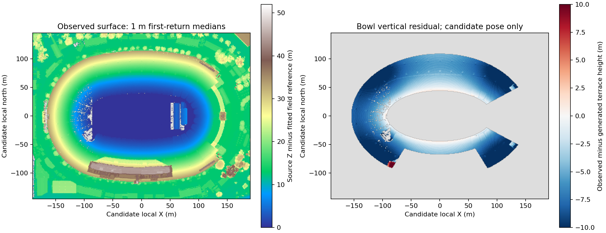

# Updated geometry validation

Audit date: 2026-11-27 in Los Angeles (some UTC acquisitions extend into November 28). Baseline: `a56ec755e188494fd935c0ac62bf9f817aedc9cd`. App geometry revision remains **0.2.0**; CAD remains **R001**.

**Native-file follow-up:** the earlier native-download exception is resolved. Both original tiles are acquired, completely decoded and identified as EPSG:6340 / EPSG:5703 (NAVD88 / Geoid18). A 50,000-point comparison confirms native/EPT encoding consistency; it does not validate physical model accuracy. See [the follow-up](../../../research/coliseum-geospatial/evidence/NATIVE_LAZ_FOLLOWUP.md). The paragraphs below describe the original audit state.

## Separate conclusions

| Validation category | Outcome | What it establishes |
| --- | --- | --- |
| Source transcription | **13/13 numeric matches** | Original ft/in controls converted independently, including two historic approximate spans and one derived height. Conversion-check tolerance 0.00005 m is arithmetic precision, not measurement uncertainty. Re-downloaded source PDFs match catalog hashes. |
| Generated geometry consistency | **12/12 pass** | Actual mesh spans/counts and selected height relationships reproduce their inputs. Maximum residual about 0.00000354 m. Navigation and existing GLB import checks also pass. |
| CAD/source/export consistency | **Pass** | Existing snapshot and scratch rebuild: 11 DXF dimensions, 112 valid native shapes, 111 IFC components, seven storeys, IFC schema/EXPRESS checks and CAD/GLB axes/units. Rebuild maximum IFC/native bound difference 0.02455 m; GLB coordinate round trip 0.00000763 m. These are representation checks. |
| Independently observed physical diagnostics | **Executed, conditional** | Acquired airborne points compared to a fitted field plane and estimated bowl terrace heights, with masks and stated conditioning. Findings below. |
| Accepted physical geometry | **Not validated** | No accepted site control, feature-specific tolerances or independently verified complete feature boundaries. No SR-3D-10 pass. |
| Estimated/unobserved geometry | **Unverified** | Bowl profiles/rows/seats, tower footprint/floors, arch details, all schematic circulation and exterior context. Hidden interiors and clearance/gradient data are missing. |

## PR review and reproduction

PR #1 head `e5a4c24af1cba3279e0609c9e4355807f9ab6b58` supplies acquisition scaffolding, 20 historical curb-ramp records and ten intersecting street segments. Its four original offline tests reproduce. Counts/provenance were checked; its archived statements about failed new-data acquisition describe that earlier run. The new evidence directory records successful downloads separately. Ramp inventory presence remains a fieldwork candidate, not route certification.

PR #2 head `d6b481b8aa40c20084d6899998b98c1a95007cc0` correctly limits its 13/13 result to transcription and identifies five unresolved areas. This iteration independently reruns the 12 generator checks and existing GLB import, reopens the native CAD snapshot, validates original exports and rebuilds the CAD package in `work/` without replacing the reference issue. Source PDF pages were checked again: S01 PDF pp. 8/21/43 (printed 6/19/41), S04 PDF p. 2.

The hidden historic check in `model.js` has been replaced with an explicit `notValidatedChecks` record, using corrected measurement ID **M158**. The minimum-width M019 control is also explicitly unresolved. These records have no passing tolerance. All original requirement wording and dimensional inputs are preserved.

## Independent observations and uncertainty

The exact method and statistics are in [independent-diagnostics.json](../../../research/coliseum-geospatial/evidence/reports/independent-diagnostics.json). Calibration and validation use disjoint west/east half-boxes inside the field (each 35 × 24 m). Vertical translation is the median of 12,971 west returns; no height-based outlier removal is applied. The 12,716 east returns are held out. All are class 1. Point counts are not independent survey checkpoints and adjacent laser returns are spatially correlated; no confidence interval or effective sample size is asserted.

Candidate horizontal placement uses the center/major axis of the minimum rotated rectangle of 2008 courtyard OBJECTID 1282840, with **no fitted scale**. This does not establish correspondence to the chosen model origin. Approximate origin: **−118.28785°, 34.01404°**; grid rotation **−0.713°** from UTM easting; fitted source Z **42.55 m**. Computed coordinates are serialized at numerical precision for reproduction, not asserted survey precision. The transform is a sidecar and is **not applied to the app or CAD**.

| Conditional comparison | N | RMSE | Median absolute | P95 absolute | Maximum absolute |
| --- | ---: | ---: | ---: | ---: | ---: |
| Withheld field interior vs fitted horizontal plane | 12,716 returns | 0.027 m | 0.020 m | 0.050 m | 0.100 m |
| Observed bowl cell median minus generated terrace height | 28,558 cells | 7.249 m | 6.646 m | 10.931 m | 22.255 m |
| Field DEM minus sampled point Z (same survey) | 424 samples | 11.253 m | 11.252 m | 11.328 m | 11.366 m |
| Exterior class-2 DEM minus point Z (same survey) | 6,388 samples | 0.070 m | 0.009 m | 0.044 m | 4.178 m |

The bowl metric evaluates the generator's elliptical terrace interpolation at each 1 m grid-cell center. Noise classes 7/18 and withheld flags are excluded; at least three usable first returns are required per observed cell. Returns can hit seats, fixtures, vegetation or people. It is a **vertical raster-to-terrace diagnostic**, not nearest-surface distance or accepted physical positional RMSE. **515/29,073** modeled bowl cells lack the required observations. The **98.23%** occupied-cell fraction is not complete 3D surface coverage. No holes are filled for validation.

The field DEM discrepancy is localized relative to exterior samples. Ground-class exclusion/interpolation across the depression is an inference; native production-history verification is still required. The DEM and point cloud derive from the same acquisition and are not mutually independent accuracy evidence. No global offset is estimated from their field difference.

## Registration and source limits

[Candidate transformation](../../../research/coliseum-geospatial/evidence/reports/candidate-registration.json) retains separate horizontal and vertical assumptions. EPT metadata declares EPSG:3857 with no vertical CRS. The original work-unit report declares EPSG:6340 and NAVD88/GEOID18; the DEM header declares EPSG:26911. No geoid conversion was applied. The chosen PROJ horizontal operations report nominal accuracies of 2 m (EPT/county to NAD83(2011)) and 6 m (NAD83(2011) to generic NAD83 DEM coordinates). These operation metadata are not measured site errors. Absolute alignment and shape error are not separable with sufficient certainty for acceptance yet.

The USGS work-unit report describes a theoretical/compiled horizontal accuracy of 0.27 m at 95%, and the USGS acceptance summary describes a 0.098 m vertical target at 95% for open nonvegetated terrain. Neither is a site-specific Coliseum result or a guarantee on stairs, roofs or doorways. EPT quantization is 0.01 m; it does not establish 0.01 m physical accuracy.

Geospatial raw files are preserved in the ignored local cache and indexed with exact URLs, timestamps (or explicitly labeled initial file-mtime proxies), byte sizes and SHA-256. Current raw native tiles could not be completed; the bounded probe returned 429. The absence of native CRS verification is retained as an exception, not inferred away from plausible elevations.

## Artifact decision and readiness

No geometry dimensions are changed. The acquired data justifies discrepancy and classification findings, but does not yet resolve the source/model boundary correspondence or accepted pose needed to replace an entire bowl, field outline, floor or route. Existing reusable GLBs, IFC, FreeCAD and DXFs remain the documented reference issue. The app's validation schema and packaged source are updated; a fresh GLB export is also compared with the existing binary to verify that geometry is unchanged.

Accessible wayfinding additionally requires verified topology, clearances, landings, slopes and current operational access. Crowd-flow analysis requires connected physical walking areas, obstacles, portal widths and calibrated movement assumptions. Those prerequisites are not supplied by this exterior scan or by the current game traversal tests. See the [next-iteration priorities](README.md) and [pending requirement proposal](SR-3D-10-change-proposal.md).
